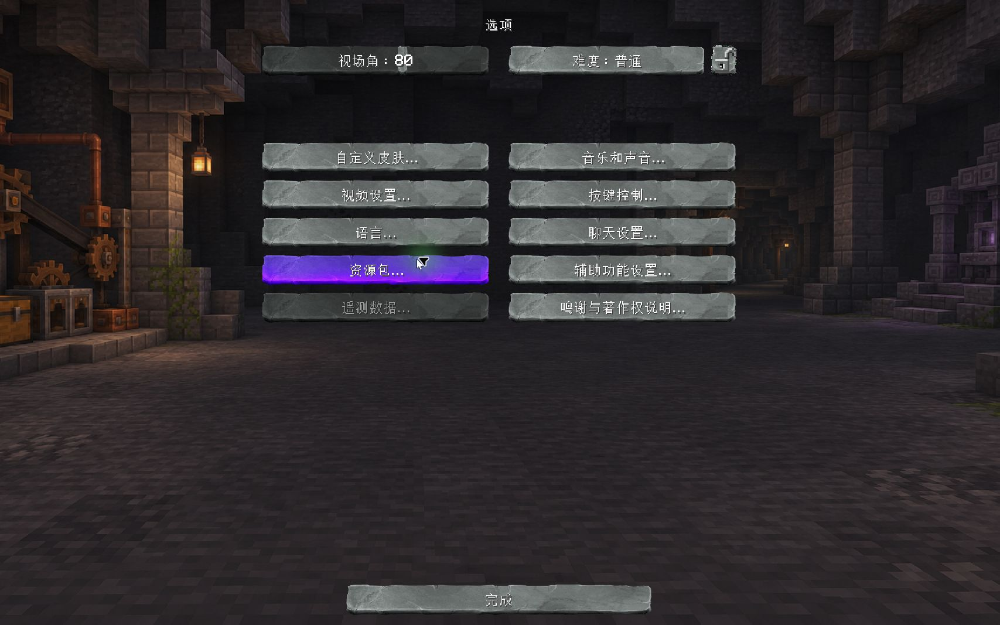

# StoneUI · 可选石板界面

为石头世界 4 提供石板控件和低饱和度的地下工坊背景。**这是客户端可选附加包，不随汉化包安装，不会自动启用，也不是存档数据包。** 汉化本身不依赖它。



## 下载与安装

已验收环境：**StoneBlock 4 1.24.1 / Minecraft 1.21.1 / NeoForge 21.1.262 / Java 21**。背景桥接 JAR 声明了精确的 Minecraft、NeoForge 版本依赖；其他版本需另行适配验证。

| 按需选择 | 文件 | 手动操作 |
| --- | --- | --- |
| 石板控件 | [StoneBlock4_StoneUI.zip](packages/StoneBlock4_StoneUI.zip?raw=true) | 将 ZIP 原样放入实例的 `resourcepacks` 文件夹，再在游戏中手动启用。无需 JAR。 |
| 设置背景 | [sb4-stone-ui-bridge.jar](packages/sb4-stone-ui-bridge.jar?raw=true) | 正常退出游戏，将 JAR 放入同一客户端实例的 `mods` 文件夹；启动后保持上述资源包启用。 |

可以只装资源包。只装桥接 JAR 时，不会改变背景或启用资源包。不要把文件放进服务器或存档的 `datapacks`。下载页面如显示文件预览，请使用 **Download raw file**，避免保存成网页。

已有旧的 StoneUI 目录版、ZIP 版或同名 JAR 时，先备份并移走旧版本，再放入这份完整包；不要叠加启用旧增量。需要覆盖其他资源包的同名原版控件时，将 StoneUI 放在资源包列表中更高的位置。它不会修改资源包顺序。

## 覆盖范围

- 替换 27 张原版控件贴图：按钮、滑块、输入框、选项卡、滚动条、复选框等。文字仍由游戏绘制，保留当前语言、字体和动态设置值。
- 模组复用原版控件贴图时自然继承石板外观；保留 Sodium、Iris、Create/Catnip、CarbonConfig、FTB 等自有界面。没有覆盖它们的图标、配色或专属资源命名空间。
- 背景桥接只匹配 [VanillaOptionsScope.java](bridge/src/main/java/cn/codex/stoneui/VanillaOptionsScope.java) 列出的 12 个原版设置类，不匹配模组子类或替代界面。画面保持比例并居中裁切，不平铺。
- 不包含首页三个自定义按钮、FancyMenu 布局、汉化词条或玩法内容。首页按钮与汉化修复由独立的 [PR #46](https://github.com/VM-Chinese-translate-group/StoneBlock4-Chinese/pull/46) 提供；本包不依赖该 PR。

## 停用与卸载

在资源包列表中停用 StoneUI，并等待资源重载完成，控件即可恢复为其他已启用资源提供的样式，背景桥接也随之停用。完整卸载时，正常退出游戏，移走上述 ZIP 和 JAR。无需修改存档、汉化文件或其他模组配置。

## 维护与验证

本目录位于 `CNPack` 之外；现有汉化发布流程只打包 `CNPack`。这里没有安装器、自动启用脚本，也没有接入汉化更新器。将来发布时请继续将本包作为**单独下载、手动安装**的可选内容，勿复制进 `CNPack`。

- [资源来源说明](docs/PROVENANCE.md)：原石板素材、AI 生成背景及授权范围说明。
- [验收范围](docs/VALIDATION.md)：实际测试过的菜单、开关恢复和兼容边界。
- [SHA256SUMS.txt](SHA256SUMS.txt) / [manifest.json](manifest.json)：发布文件及 46 项资源的校验值。
- `resourcepack/`：ZIP 中所有资源的展开版本，便于审查和修改。
- `bridge/`：背景桥接完整源码与离线构建脚本。构建只写入此目录的 `build/`，不会安装进游戏。

校验交付文件和展开资源：

```sh
python verify.py
```

重建资源包（只需 Python 3.10 或更高版本的标准库）：

```sh
python build.py
```

桥接 JAR 需要 Java 21 JDK，以及曾成功启动上述版本的 PrismLauncher 运行库。脚本不下载或打包 Minecraft、NeoForge 本体。将占位路径换成自己的绝对路径：

```sh
python bridge/build.py --prism-root "<PrismLauncher 数据目录>" --jdk "<Java 21 JDK 目录>"
python verify.py --rebuilt
```

也可用 `SB4_PRISM_ROOT`、`SB4_JDK` 环境变量提供这两条路径。生成物位于 `build/StoneBlock4_StoneUI.zip` 和 `bridge/build/sb4-stone-ui-bridge.jar`。重建归档的 ZIP 元数据可能不同，因此 `--rebuilt` 按每个成员的字节比较，而不是要求整个归档哈希相同。

桥接附带可手动调用的客户端诊断命令：`/stoneui menus` 将已注册的模组配置菜单清单写入 `logs/stone-ui-menu-catalog.json`；`/stoneui open <modid>` 打开模组自己的配置页。诊断命令不修改设置，也不自动遍历菜单。
